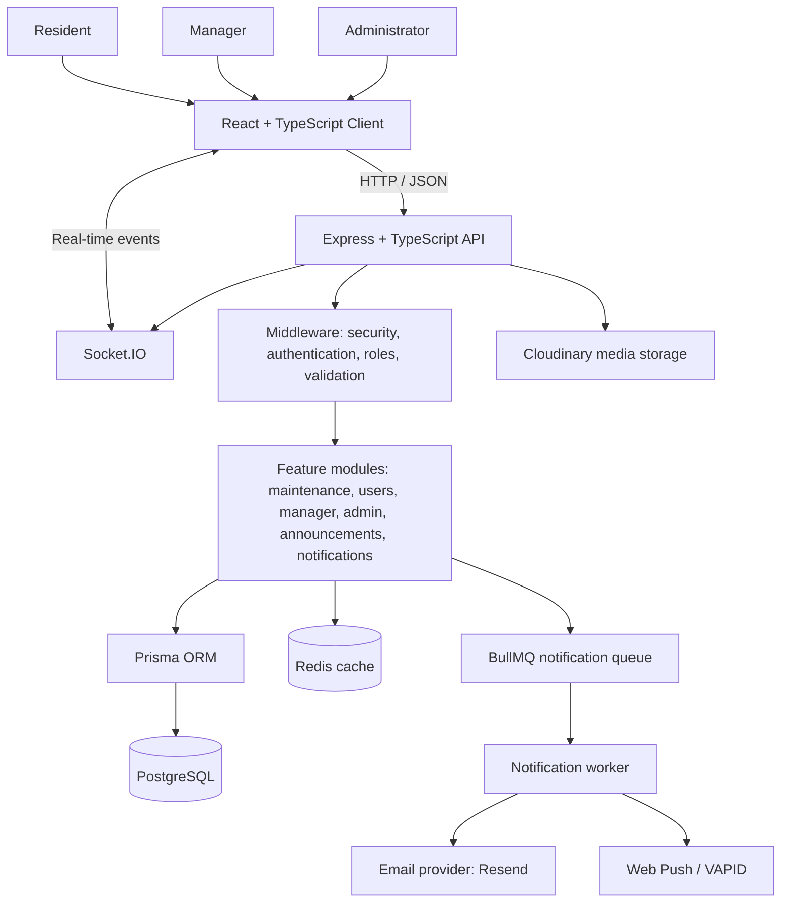
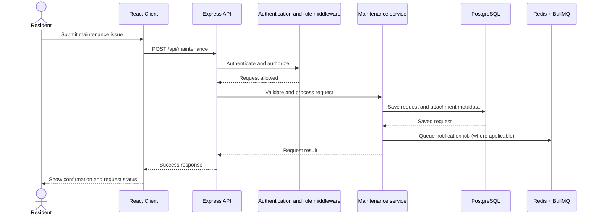

<div align="center">

# 🏡 CommunityCare

### Community Maintenance & Resident Services Platform

**A centralized platform to report, track, and resolve maintenance issues inside residential communities.**


[Overview](#-what-is-communitycare) · [Features](#-key-features) · [Architecture](#-system-architecture) · [Setup](#-getting-started) · [API](#-api-documentation)

</div>

---

## 🏡 What is CommunityCare?

CommunityCare is a web platform that helps residents and community management teams manage everyday maintenance issues in one place. Instead of reporting a broken light, water leak, or another problem through scattered messages, residents can submit a request and follow its progress. Authorized managers can review requests, coordinate the response, and update request statuses as work progresses.

The platform also brings together community announcements, role-specific dashboards, notifications, and administrative tools for a more organized community experience.

### The problem it solves

- Maintenance requests can get lost across calls, chats, and paper records.
- Residents may not know whether an issue has been received or reviewed.
- Managers need a clear view of open requests and their current status.
- Important updates and community announcements need a central place.
- Community teams need a consistent way to record and follow maintenance work.

### How it works

1. A resident signs in and submits a maintenance request with a category, description, priority, and optional photos.
2. The request is saved and appears in the maintenance workflow.
3. An authorized manager reviews the request and coordinates the next steps.
4. The request status is updated as the issue progresses.
5. Residents and relevant users can follow updates through the platform's notification features.

> Available actions and permissions depend on the user's role and the request's current status.

---

## 📸 Screenshots

The screenshots below use the filenames currently present in the project's `docs/images/` folder. Keep the filenames and paths in this README in sync with the files committed to GitHub. Paths and filename capitalization must match exactly.

### Resident Dashboard

Residents can view their maintenance requests and check their progress.


### Admin Dashboard

Administrators can access the platform's administrative overview and management tools.


### Create a Maintenance Request

The request form provides a place to describe a community issue and submit it for review.


### Request Details

The request details screen provides information about an individual maintenance request.


---

## ✨ Key Features

### Maintenance management

- Create maintenance requests with a title, description, category, priority, unit, and optional photo attachments.
- View and filter requests, including by status, priority, and category.
- Track request progress through defined statuses.
- Keep resident requests associated with the relevant users and units.

### Role-based experiences

- **Residents:** submit issues and follow their maintenance requests.
- **Managers:** review community maintenance requests, coordinate responses, and monitor progress.
- **Administrators:** access administrative dashboards and management tools.

### Community communication

- Community announcements.
- In-app notifications with read/unread state.
- Configurable notification preferences.
- Browser push notifications when configured.
- Real-time event infrastructure using Socket.IO.

### Authentication and account support

- Authentication routes and protected API endpoints.
- Role-based authorization middleware.
- Google sign-in integration, which requires credentials to be configured.
- Email-related services, which require provider configuration.

### Operational and developer features

- Dashboard and activity data for administrative workflows.
- PostgreSQL persistence through Prisma ORM.
- Redis integration for caching and queue infrastructure.
- BullMQ notification queue with retry and backoff settings.
- Image upload validation and Cloudinary integration.
- API documentation through Swagger UI in non-production mode.
- Automated tests using Vitest and Supertest.
- Dockerfiles and a Docker Compose configuration.

---

## 🧰 Technology Stack

| Layer | Technologies |
|---|---|
| Frontend | React 19, TypeScript, Vite |
| UI and styling | Tailwind CSS 4, Radix UI, Lucide React, Framer Motion |
| Client-side data and navigation | TanStack Query, React Router |
| Backend | Node.js, Express 5, TypeScript |
| Database | PostgreSQL, Prisma ORM |
| Cache and background jobs | Redis, BullMQ, ioredis |
| Real-time communication | Socket.IO |
| Authentication integrations | JWT-based utilities, Google OAuth integration, cookie parsing |
| Media | Cloudinary, Multer, file-type validation |
| Notifications | Resend email integration, Web Push (VAPID), Socket.IO, BullMQ |
| API documentation | Swagger UI, swagger-jsdoc |
| Testing | Vitest, Supertest |
| Containerization | Docker, Docker Compose |

---

## 🏗️ System Architecture

CommunityCare uses a **frontend + API server + supporting services** architecture. The React client sends HTTP requests to the Express API. The API applies validation, authentication, and role checks before feature modules work with PostgreSQL through Prisma. Redis supports caching and queued jobs, while background workers process notification jobs. Socket.IO and Web Push provide real-time and browser-push notification paths when configured.



### Maintenance request lifecycle



### Backend organization

The server uses feature-based modules, with shared infrastructure separated into middleware, configuration, libraries, utilities, and a background worker.

```text
server/src/
├── app.ts                         # Express app, middleware, API route registration
├── server.ts                      # Server startup
├── config/                        # Redis, queues, sockets, email, media, Swagger, etc.
├── middleware/                    # Authentication, role checks, rate limiting, uploads, errors
├── lib/                           # Shared integrations such as Prisma
├── modules/
│   ├── auth/                      # Authentication and Google sign-in
│   ├── maintenance/               # Maintenance request workflow
│   ├── users/                     # User operations
│   ├── manager/                   # Manager workflows
│   ├── admin/                     # Admin dashboards and activity
│   ├── dashboard/                 # Dashboard data
│   ├── announcements/             # Community announcements
│   ├── notifications/             # In-app and push notifications
│   ├── notification-preferences/  # Notification settings
│   └── locations/                 # Community and unit location data
├── utils/                         # Caching, OTP, password reset, escaping, uploads
├── worker/                        # Background notification worker
└── tests/                         # API, service, security, and integration tests
```

The frontend is organized around shared components, contexts, layouts, and feature folders, including administration, announcements, and related workflows.

---

## 🔐 Security Notes

Security controls present in the codebase include Helmet, configured CORS, request-body size limits, cookie parsing, authentication and role middleware, request validation, rate-limiting utilities, and image validation. These controls still need correct production configuration and review before deployment.

**Before publishing or deploying:**

- Never commit real `.env` files, API keys, OAuth secrets, VAPID private keys, database passwords, or production credentials.
- Review `server/docker-compose.yml` and replace hard-coded credentials with environment variables or Docker secrets.
- Use HTTPS in production and configure secure cookie options, allowed origins, and trusted proxy settings for your hosting environment.
- Configure least-privilege database access and restrict database and Redis ports in production.
- Review upload limits, authorization rules, error handling, and logging before handling real resident data.

---

## 🚀 Getting Started

### Prerequisites

Install the following before starting the project:

- Node.js compatible with the project dependencies (a current LTS release is a sensible starting point).
- npm.
- PostgreSQL.
- Redis.
- Git.

Docker and Docker Compose are optional if you prefer a container-based local setup.

### 1. Clone the repository

```bash
git clone https://github.com/alanbabu518-spec/Community-Maintenance-Platform.git
cd Community-Maintenance-Platform
```

### 2. Configure backend environment variables

Create the backend environment file from the example.

**PowerShell:**

```powershell
cd server
Copy-Item .env.example .env
```

Edit `server/.env` and set the values required for your local setup. At minimum, configure a PostgreSQL connection string, a strong JWT secret, the frontend URL, and a Redis URL. Configure optional integrations only if you intend to use them.

Example environment variable format (use your own values; do not commit real credentials):

```dotenv
DATABASE_URL="postgresql://<db-user>:<db-password>@localhost:5432/<database-name>"
JWT_SECRET="<long-random-secret>"
CLIENT_URL="http://localhost:5173"
COOKIE_MAX_AGE=604800000
REDIS_URL="redis://localhost:6379"

# Optional integrations
CLOUDINARY_CLOUD_NAME=""
CLOUDINARY_API_KEY=""
CLOUDINARY_API_SECRET=""
RESEND_API_KEY=""
VAPID_PUBLIC_KEY=""
VAPID_PRIVATE_KEY=""
VAPID_SUBJECT=""
```

Some integrations may require additional environment variables. Check the relevant files under `server/src/config/` and the Google and email integration modules. Never use placeholder values in a deployed environment.

### 3. Install backend dependencies

From the `server/` directory:

```bash
npm install
```

### 4. Prepare the database

Make sure PostgreSQL is running and `DATABASE_URL` points to an existing database with appropriate permissions. Then generate the Prisma client and apply the project's migrations:

```bash
npx prisma generate
npx prisma migrate deploy
```

For a local development database where migrations have not been created, follow the project's Prisma migration workflow before using `prisma migrate dev`.

### 5. Start Redis

Start Redis locally or update `REDIS_URL` to point to your Redis instance. Confirm that the server can connect before starting the application, because queue and cache setup depend on Redis configuration.

### 6. Start the backend

From `server/`:

```bash
npm run dev
```

Check `server/src/server.ts` and your environment for the configured port. The supplied Docker configuration uses port `5000`.

Health endpoint:

```text
http://localhost:5000/api/health
```

In non-production mode, Swagger documentation is available at:

```text
http://localhost:5000/api-docs
```

### 7. Configure and start the frontend

Open a second terminal at the repository root:

```powershell
cd client
npm install
Copy-Item .env.example .env
```

Set `VITE_API_URL` to the backend URL used by the client. The example value is `http://localhost:5000`.

Start Vite:

```bash
npm run dev
```

Open the local URL printed by Vite (commonly `http://localhost:5173`).

### 8. Useful commands

**Backend (`server/`):**

```bash
npm run dev           # Run API in development mode
npm start             # Start API using tsx
npm test              # Run Vitest in watch mode
npm run test:run      # Run tests once
npm run test-db       # Run the database connection test script
npm run create:admin  # Run the admin creation script
```

**Frontend (`client/`):**

```bash
npm run dev      # Start Vite development server
npm run build    # Type-check and build production assets
npm run lint     # Run ESLint
npm run preview  # Preview the production build locally
```

> The admin creation script may change database state. Review its prompts and source before running it.

---

## 🐳 Docker Setup

A Docker Compose configuration is included under `server/`. Before using it, inspect the file and replace any hard-coded database credentials with environment-based configuration. Do not use development credentials in production.

From the `server/` directory, after configuring a suitable `.env` file:

```bash
docker compose config
docker compose up --build
```

`docker compose config` helps validate the resolved configuration. If it prints secrets, do not share the output publicly. Check the Compose file for the actual port mappings and service health before opening the app.

To stop containers:

```bash
docker compose down
```

To stop containers and remove the named database volume (this permanently deletes the local database data stored in that volume):

```bash
docker compose down -v
```

---

## 📚 API Documentation

The API is grouped by feature and mounted under `/api`.

| Area | Base path | Purpose |
|---|---|---|
| Health | `/api/health` | API health check |
| Authentication | `/api/auth` | Sign-in and account authentication routes |
| Users | `/api/users` | User-related operations |
| Maintenance | `/api/maintenance` | Create, list, and manage maintenance requests |
| Locations | `/api/locations` | Community and unit location data |
| Dashboard | `/api/dashboard` | Dashboard information |
| Manager | `/api/manager` | Manager workflows |
| Admin | `/api/admin` | Administrative workflows and activity |
| Notifications | `/api/notifications` | In-app and push notification operations |
| Notification preferences | `/api/notification-preferences` | User notification preferences |
| Announcements | `/api/announcements` | Community announcements |

For endpoint details, request schemas, and response examples, run the server in non-production mode and open `http://localhost:5000/api-docs`. Authentication and role permissions apply to protected endpoints.

---

## 🧪 Testing and Quality

Backend tests use Vitest and Supertest. The repository includes tests covering authentication, maintenance APIs and services, health checks, caching, notifications, sockets, image validation, and security-related edge cases.

Run the backend test suite from `server/`:

```bash
npm run test:run
```

Run frontend linting and a production build from `client/`:

```bash
npm run lint
npm run build
```

Tests that depend on PostgreSQL, Redis, environment variables, or external integrations need those dependencies configured according to the test setup.

---

## 🗺️ Suggested Roadmap

Potential next steps include:

- Add a polished demo deployment and screenshots for the main user experiences.
- Document user journeys and maintenance request status transitions.
- Add seed data for a safe local demo environment.
- Document setup for Google OAuth, email, Cloudinary, and Web Push.
- Add CI checks for linting, type checking, tests, and builds.
- Improve deployment documentation and move secrets to a managed secret store.

---

## 🤝 Contributing

Contributions, ideas, and bug reports are welcome.

1. Fork the repository.
2. Create a branch: `git checkout -b feature/your-feature`.
3. Make a focused change and add or update tests where appropriate.
4. Run the relevant checks.
5. Open a pull request describing the change and how it was tested.

---

## 📄 License

No license file was identified in the supplied project material. Add a `LICENSE` file and update this section before presenting the repository as open source. Without a license, default copyright restrictions generally apply.

---

<div align="center">

**CommunityCare — helping communities manage maintenance with more clarity and less friction.**

</div>
