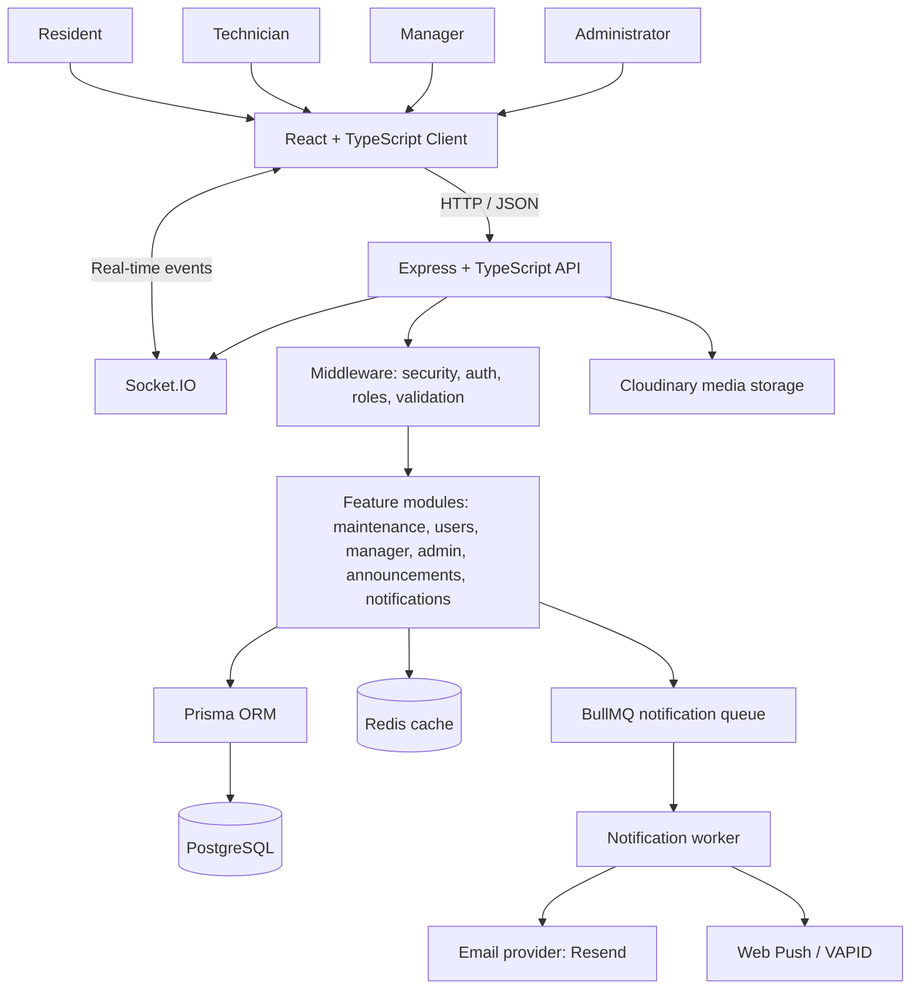
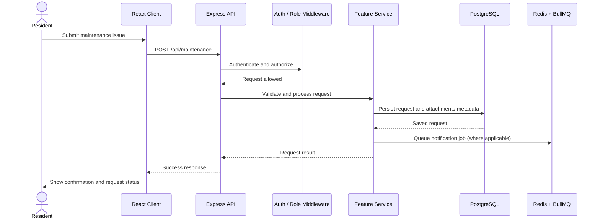
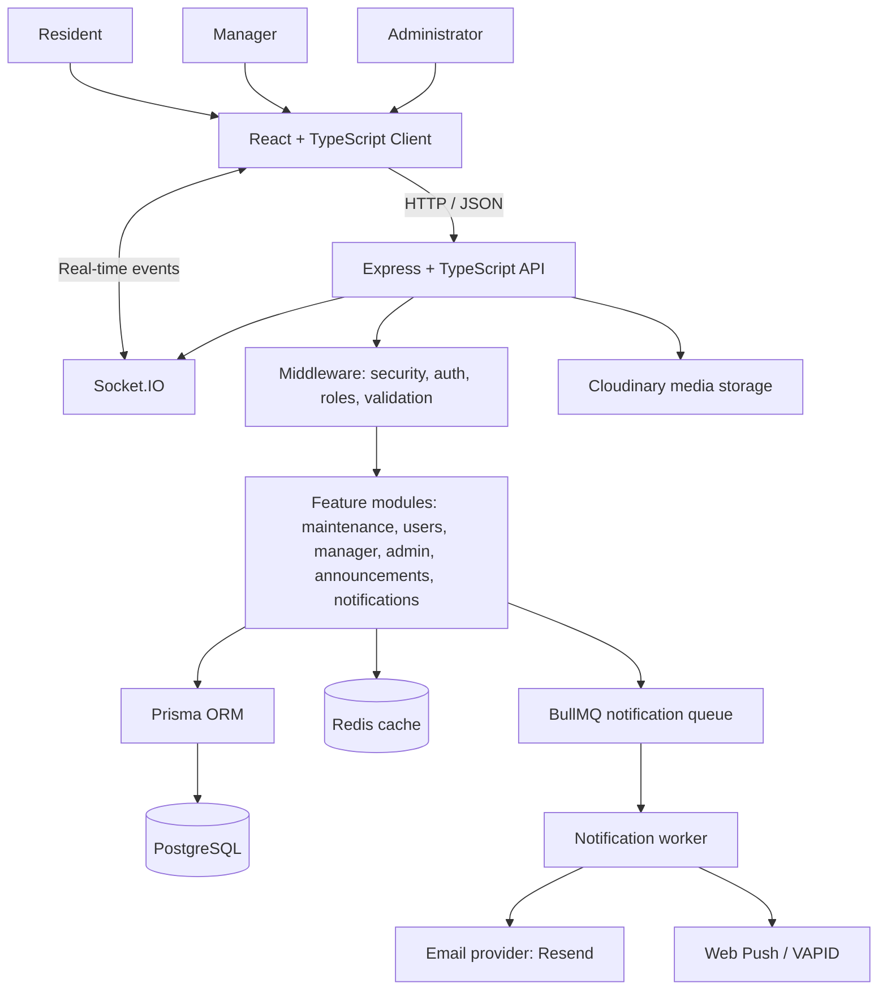

<div align="center">

# CommunityCare
<<<<<<< HEAD
### Community Maintenance & Resident Services Platform

**A centralized platform to report, assign, track, and resolve maintenance issues inside residential communities.**

<!-- Replace the placeholder below with a screenshot of your landing page. -->


[Overview](#-what-is-communitycare) · [Features](#-key-features) · [Architecture](#-system-architecture) · [Setup](#-getting-started) · [API](#-api-documentation)

=======

## Community Maintenance & Resident Services Platform

**A centralized platform to report, track, and resolve maintenance issues inside residential communities.**

<!-- Replace the placeholder below with a screenshot of your landing page. -->


[Overview](#-what-is-communitycare) · [Features](#-key-features) · [Architecture](#-system-architecture) · [Setup](#-getting-started) · [API](#-api-documentation)

>>>>>>> 24f1b7b (docs: update CommunityCare README)
</div>

---

## 🏡 What is CommunityCare?

<<<<<<< HEAD
CommunityCare helps residents and community management teams handle everyday maintenance work in one place. Instead of reporting a broken light, water leak, or other issue through scattered messages, a resident can submit a request and follow its progress. Authorized managers can review requests and assign technicians, while technicians can work on assigned jobs and update their status.

The platform also brings together community announcements, role-specific dashboards, notifications, and administrative tools. It is designed around the different responsibilities of **residents, technicians, managers, and administrators**.
=======
CommunityCare helps residents and community management teams handle everyday maintenance work in one place. Instead of reporting a broken light, water leak, or other issue through scattered messages, a resident can submit a request and follow its progress. Authorized managers can review requests, coordinate the response, and update the request as work progresses.

The platform also brings together community announcements, role-specific dashboards, notifications, and administrative tools. It is designed around the different responsibilities of **residents, managers, and administrators**.
>>>>>>> 24f1b7b (docs: update CommunityCare README)

### The problem it solves

- Maintenance requests can get lost across calls, chats, and paper records.
<<<<<<< HEAD
- Residents may not know whether an issue has been received or assigned.
- Managers need a clear view of open work and technician assignments.
- Important updates and community announcements need a central place.

### The intended workflow

1. A resident signs in and submits a maintenance request with its category, description, priority, and optional photos.
2. The request is saved and appears in the maintenance workflow.
3. An authorized manager reviews it and assigns a technician where appropriate.
4. The technician updates the request as work progresses.
5. Residents and relevant users can follow updates through the platform's notification features.

> Exact actions and permissions depend on the user's role and the request's current status.

## 🖼️ Screenshots

Add your own screenshots to `docs/images/` and use the filenames below, or update the paths to match your images.

| Landing page | Resident dashboard |
|---|---|
| `` | `` |
| **Manager dashboard** | **Technician workspace** |
| `` | `` |
| **Create maintenance request** | **Request details and status** |
| `` | `` |

<!-- Optional: add a short product demo GIF or video link here. -->

## ✨ Key features

### Maintenance management
- Create maintenance requests with a title, description, category, priority, unit, and optional photo attachments.
- View and filter requests, including by status, priority, and category.
- Assign technicians and track request progress through defined statuses.
- Keep resident requests and technician assignments associated with the relevant users and units.

### Role-based experiences
- **Residents:** submit issues and follow their maintenance requests.
- **Technicians:** view assigned work and update job progress.
- **Managers:** oversee community maintenance and coordinate assignments.
- **Administrators:** access administrative dashboards and management tools.

### Community communication
- Community announcements.
- In-app notifications and read/unread state.
- Configurable notification preferences.
- Browser push-notification support when configured.
- Real-time event infrastructure using Socket.IO.

### Authentication and account support
- Authentication routes and protected API endpoints.
- Role-based authorization middleware.
- Google sign-in integration is included in the codebase and requires credentials to be configured.
- Email-related services are present and require provider configuration.

### Operational and developer features
- Dashboard and activity data for administrative workflows.
- PostgreSQL persistence through Prisma ORM.
- Redis integration for caching and queue infrastructure.
- BullMQ notification queue with retry/backoff settings.
- Image upload validation and Cloudinary integration.
- API documentation through Swagger UI in non-production mode.
- Automated tests using Vitest and Supertest.
- Dockerfiles and a Docker Compose configuration are included.

## 🧰 Technology stack

| Layer | Technologies |
|---|---|
| Frontend | React 19, TypeScript, Vite |
| UI and styling | Tailwind CSS 4, Radix UI, Lucide React, Framer Motion |
| Client-side data and navigation | TanStack Query, React Router |
| Backend | Node.js, Express 5, TypeScript |
| Database | PostgreSQL, Prisma ORM |
| Cache and background jobs | Redis, BullMQ, ioredis |
| Real-time communication | Socket.IO |
| Authentication integrations | JWT-based utilities, Google OAuth integration, cookie parsing |
| Media | Cloudinary, Multer, file-type validation |
| Notifications | Resend email integration, Web Push (VAPID), Socket.IO, BullMQ |
| API documentation | Swagger UI, swagger-jsdoc |
| Testing | Vitest, Supertest |
| Containerization | Docker, Docker Compose |

## 🏗️ System architecture

The application follows a **frontend + API server + supporting services** architecture. The React client sends HTTP requests to the Express API. The API applies validation, authentication, and role checks before using module services and repositories to work with PostgreSQL through Prisma. Redis supports caching and queued jobs; background workers process notification jobs. Socket.IO and Web Push provide real-time and browser-push notification paths when configured.



### Request lifecycle (simplified)



### Backend organization

The server uses feature-based modules, with common infrastructure separated into middleware, configuration, libraries, utilities, and a worker.

```text
server/src/
├── app.ts                 # Express app, middleware, API route registration
├── server.ts              # Server startup
├── config/                # Redis, queues, sockets, email, media, Swagger, etc.
├── middleware/            # Authentication, role checks, rate limiting, uploads, errors
├── lib/                   # Shared integrations such as Prisma
├── modules/
│   ├── auth/              # Authentication and Google sign-in
│   ├── maintenance/       # Maintenance request workflow
│   ├── users/             # User operations
│   ├── manager/            # Manager workflows
│   ├── admin/              # Admin dashboards and activity
│   ├── dashboard/          # Dashboard data
│   ├── announcements/      # Community announcements
│   ├── notifications/      # In-app and push notifications
│   ├── notification-preferences/
│   └── locations/          # Community / unit location data
├── utils/                  # Caching, OTP, password reset, escaping, uploads
├── worker/                 # Background notification worker
└── tests/                  # API, service, security, and integration tests
=======

- Residents may not know whether an issue has been received or assigned.

- Managers need a clear view of open requests and maintenance progress.

- Important updates and community announcements need a central place.

### The intended workflow

1. A resident signs in and submits a maintenance request with its category, description, priority, and optional photos.

2. The request is saved and appears in the maintenance workflow.

5. Residents and relevant users can follow updates through the platform's notification features.

> Exact actions and permissions depend on the user's role and the request's current status.

## 🖼️ Screenshots

Add screenshots of your actual application to `docs/images/`. Update the filenames below if your image names differ.

### Landing page


### Resident dashboard


### Manager dashboard


### Create maintenance request


### Request details and status


<!-- Optional: add a short product demo GIF or video link here. -->

## ✨ Key features

### Maintenance management

- Create maintenance requests with a title, description, category, priority, unit, and optional photo attachments.

- View and filter requests, including by status, priority, and category.

- Coordinate maintenance requests and track progress through defined statuses.

- Keep resident requests associated with the relevant users and units.

### Role-based experiences

- **Residents:** submit issues and follow their maintenance requests.

- **Managers:** oversee community maintenance and coordinate the response.

- **Administrators:** access administrative dashboards and management tools.

### Community communication

- Community announcements.

- In-app notifications and read/unread state.

- Configurable notification preferences.

- Browser push-notification support when configured.

- Real-time event infrastructure using Socket.IO.

### Authentication and account support

- Authentication routes and protected API endpoints.

- Role-based authorization middleware.

- Google sign-in integration is included in the codebase and requires credentials to be configured.

- Email-related services are present and require provider configuration.

### Operational and developer features

- Dashboard and activity data for administrative workflows.

- PostgreSQL persistence through Prisma ORM.

- Redis integration for caching and queue infrastructure.

- BullMQ notification queue with retry/backoff settings.

- Image upload validation and Cloudinary integration.

- API documentation through Swagger UI in non-production mode.

- Automated tests using Vitest and Supertest.

- Dockerfiles and a Docker Compose configuration are included.

## 🧰 Technology stack

| Layer | Technologies |
|---|---|
| Frontend | React 19, TypeScript, Vite |
| UI and styling | Tailwind CSS 4, Radix UI, Lucide React, Framer Motion |
| Client-side data and navigation | TanStack Query, React Router |
| Backend | Node.js, Express 5, TypeScript |
| Database | PostgreSQL, Prisma ORM |
| Cache and background jobs | Redis, BullMQ, ioredis |
| Real-time communication | Socket.IO |
| Authentication integrations | JWT-based utilities, Google OAuth integration, cookie parsing |
| Media | Cloudinary, Multer, file-type validation |
| Notifications | Resend email integration, Web Push (VAPID), Socket.IO, BullMQ |
| API documentation | Swagger UI, swagger-jsdoc |
| Testing | Vitest, Supertest |
| Containerization | Docker, Docker Compose |

## 🏗️ System architecture

The application follows a **frontend + API server + supporting services** architecture. The React client sends HTTP requests to the Express API. The API applies validation, authentication, and role checks before using module services and repositories to work with PostgreSQL through Prisma. Redis supports caching and queued jobs; background workers process notification jobs. Socket.IO and Web Push provide real-time and browser-push notification paths when configured.



### Request lifecycle (simplified)


### Backend organization

The server uses feature-based modules, with common infrastructure separated into middleware, configuration, libraries, utilities, and a worker.

```text

server/src/

├── app.ts                 # Express app, middleware, API route registration

├── server.ts              # Server startup

├── config/                # Redis, queues, sockets, email, media, Swagger, etc.

├── middleware/            # Authentication, role checks, rate limiting, uploads, errors

├── lib/                   # Shared integrations such as Prisma

├── modules/

│   ├── auth/              # Authentication and Google sign-in

│   ├── maintenance/       # Maintenance request workflow

│   ├── users/             # User operations

│   ├── manager/            # Manager workflows

│   ├── admin/              # Admin dashboards and activity

│   ├── dashboard/          # Dashboard data

│   ├── announcements/      # Community announcements

│   ├── notifications/      # In-app and push notifications

│   ├── notification-preferences/

│   └── locations/          # Community / unit location data

├── utils/                  # Caching, OTP, password reset, escaping, uploads

├── worker/                 # Background notification worker

└── tests/                  # API, service, security, and integration tests

>>>>>>> 24f1b7b (docs: update CommunityCare README)
```

The frontend is organized around shared components, contexts, layouts, and feature folders (including Admin, announcements, and related workflows), rather than placing all screens and API logic in one directory.

## 🔐 Security notes

Security controls present in the codebase include Helmet, configured CORS, request-body size limits, cookie parsing, authentication and role middleware, request validation, rate limiting utilities, and image validation. These controls still need correct production configuration and review before deployment.

**Important before publishing or deploying:**
<<<<<<< HEAD
- Never commit real `.env` files, API keys, OAuth secrets, VAPID private keys, database passwords, or production credentials.
- Review `server/docker-compose.yml` before using it: replace any hard-coded credentials with environment variables or Docker secrets, and use strong local-only credentials.
- Use HTTPS in production and set secure cookie options, allowed origins, and trusted proxy settings to match your hosting environment.
- Configure least-privilege database access and restrict database/Redis ports in production.
=======

- Never commit real `.env` files, API keys, OAuth secrets, VAPID private keys, database passwords, or production credentials.

- Review `server/docker-compose.yml` before using it: replace any hard-coded credentials with environment variables or Docker secrets, and use strong local-only credentials.

- Use HTTPS in production and set secure cookie options, allowed origins, and trusted proxy settings to match your hosting environment.

- Configure least-privilege database access and restrict database/Redis ports in production.

>>>>>>> 24f1b7b (docs: update CommunityCare README)
- Review upload limits, authorization rules, error handling, and logging before handling real resident data.

## 🚀 Getting started

### Prerequisites

Install the following before starting the project:

- Node.js compatible with the versions required by the project dependencies (a current LTS release is a sensible starting point).
<<<<<<< HEAD
- npm.
- PostgreSQL.
- Redis.
=======

- npm.

- PostgreSQL.

- Redis.

>>>>>>> 24f1b7b (docs: update CommunityCare README)
- Git.

Docker and Docker Compose are optional if you prefer a container-based local setup.

### 1. Clone the repository

```bash
<<<<<<< HEAD
git clone <your-repository-url>
cd Community-Maintenance-Platform-main
=======

git clone <your-repository-url>

cd Community-Maintenance-Platform-main

>>>>>>> 24f1b7b (docs: update CommunityCare README)
```

Replace `<your-repository-url>` with your Git repository URL.

### 2. Configure environment variables

Create the backend environment file from the example:

```bash
<<<<<<< HEAD
cd server
cp .env.example .env
=======

cd server

cp .env.example .env

>>>>>>> 24f1b7b (docs: update CommunityCare README)
```

On Windows PowerShell, use:

```powershell
<<<<<<< HEAD
Copy-Item .env.example .env
=======

Copy-Item .env.example .env

>>>>>>> 24f1b7b (docs: update CommunityCare README)
```

Edit `server/.env` and set the values needed for your local setup. At minimum, configure a PostgreSQL connection string, a strong JWT secret, the frontend URL, and a Redis URL. Configure optional integrations only when you intend to use them.

Example shape (use your own values; do not copy real credentials into source control):

```dotenv
<<<<<<< HEAD
DATABASE_URL="postgresql://<db-user>:<db-password>@localhost:5432/<database-name>"
JWT_SECRET="<long-random-secret>"
CLIENT_URL="http://localhost:5173"
COOKIE_MAX_AGE=604800000
REDIS_URL="redis://localhost:6379"

# Optional integrations
CLOUDINARY_CLOUD_NAME=""
CLOUDINARY_API_KEY=""
CLOUDINARY_API_SECRET=""
RESEND_API_KEY=""
VAPID_PUBLIC_KEY=""
VAPID_PRIVATE_KEY=""
VAPID_SUBJECT=""
=======

DATABASE_URL="postgresql://<db-user>:<db-password>@localhost:5432/<database-name>"

JWT_SECRET="<long-random-secret>"

CLIENT_URL="http\://localhost:5173"

COOKIE_MAX_AGE=604800000

REDIS_URL="redis\://localhost:6379"

# Optional integrations

CLOUDINARY_CLOUD_NAME=""

CLOUDINARY_API_KEY=""

CLOUDINARY_API_SECRET=""

RESEND_API_KEY=""

VAPID_PUBLIC_KEY=""

VAPID_PRIVATE_KEY=""

VAPID_SUBJECT=""

>>>>>>> 24f1b7b (docs: update CommunityCare README)
```

Some integrations may require additional environment variables depending on the code path you use. Check the relevant files under `server/src/config/` and the Google/email integration modules. Never use placeholder values in a deployed environment.

### 3. Install backend dependencies

From the `server` directory:

```bash
<<<<<<< HEAD
npm install
=======

npm install

>>>>>>> 24f1b7b (docs: update CommunityCare README)
```

### 4. Prepare the database

Make sure PostgreSQL is running and that `DATABASE_URL` points to an existing database with appropriate permissions. Then generate the Prisma client and apply the project's migrations:

```bash
<<<<<<< HEAD
npx prisma generate
npx prisma migrate deploy
=======

npx prisma generate

npx prisma migrate deploy

>>>>>>> 24f1b7b (docs: update CommunityCare README)
```

For a local development database where migrations have not yet been created or where your workflow calls for creating a migration, consult the Prisma schema and your team's migration workflow before using `prisma migrate dev`.

### 5. Start Redis

Start Redis locally or update `REDIS_URL` to point to your Redis instance. Confirm that the server can connect before starting the application, because queue/cache setup depends on Redis configuration.

### 6. Start the backend

In `server/`:

```bash
<<<<<<< HEAD
npm run dev
=======

npm run dev

>>>>>>> 24f1b7b (docs: update CommunityCare README)
```

The API is configured to run on port `5000` in the supplied Docker configuration; check `server/src/server.ts` and your environment if your local port differs.

Health endpoint:

```text
<<<<<<< HEAD
GET http://localhost:5000/api/health
=======

GET http\://localhost:5000/api/health

>>>>>>> 24f1b7b (docs: update CommunityCare README)
```

In non-production mode, Swagger documentation is mounted at:

```text
<<<<<<< HEAD
http://localhost:5000/api-docs
=======

http\://localhost:5000/api-docs

>>>>>>> 24f1b7b (docs: update CommunityCare README)
```

### 7. Configure and start the frontend

Open a second terminal at the repository root:

```bash
<<<<<<< HEAD
cd client
npm install
=======

cd client

npm install

>>>>>>> 24f1b7b (docs: update CommunityCare README)
```

Create the frontend environment file:

```bash
<<<<<<< HEAD
cp .env.example .env
=======

cp .env.example .env

>>>>>>> 24f1b7b (docs: update CommunityCare README)
```

PowerShell alternative:

```powershell
<<<<<<< HEAD
Copy-Item .env.example .env
```

Set `VITE_API_URL` to the backend URL used by the client. The example value is `http://localhost:5000`.
=======

Copy-Item .env.example .env

```

Set `VITE_API_URL` to the backend URL used by the client. The example value is `http\://localhost:5000`.
>>>>>>> 24f1b7b (docs: update CommunityCare README)

Start Vite:

```bash
<<<<<<< HEAD
npm run dev
```

Open the local URL printed by Vite (commonly `http://localhost:5173`).
=======

npm run dev

```

Open the local URL printed by Vite (commonly `http\://localhost:5173`).
>>>>>>> 24f1b7b (docs: update CommunityCare README)

### 8. Useful commands

**Backend (`server/`):**

```bash
<<<<<<< HEAD
npm run dev          # Run API in development mode
npm start            # Start API using tsx
npm test             # Run Vitest in watch mode
npm run test:run     # Run tests once
npm run test-db      # Run the database connection test script
npm run create:admin # Run the admin creation script
=======

npm run dev          # Run API in development mode

npm start            # Start API using tsx

npm test             # Run Vitest in watch mode

npm run test:run     # Run tests once

npm run test-db      # Run the database connection test script

npm run create:admin # Run the admin creation script

>>>>>>> 24f1b7b (docs: update CommunityCare README)
```

**Frontend (`client/`):**

```bash
<<<<<<< HEAD
npm run dev          # Start Vite development server
npm run build        # Type-check and build production assets
npm run lint         # Run ESLint
npm run preview      # Preview the production build locally
=======

npm run dev          # Start Vite development server

npm run build        # Type-check and build production assets

npm run lint         # Run ESLint

npm run preview      # Preview the production build locally

>>>>>>> 24f1b7b (docs: update CommunityCare README)
```

> The admin creation script may change database state. Review its prompts and source before running it.

## 🐳 Docker setup

A Docker Compose configuration is included under `server/`. Before using it, inspect the file and replace any hard-coded database credentials with environment-based configuration. Do not use development credentials in production.

From the `server/` directory, after configuring a suitable `.env` file:

```bash
<<<<<<< HEAD
docker compose config
docker compose up --build
=======

docker compose config

docker compose up --build

>>>>>>> 24f1b7b (docs: update CommunityCare README)
```

`docker compose config` helps validate the resolved configuration. If it prints secrets, do not share the output publicly. Check the Compose file for the actual port mappings and service health before opening the app.

To stop containers:

```bash
<<<<<<< HEAD
docker compose down
=======

docker compose down

>>>>>>> 24f1b7b (docs: update CommunityCare README)
```

To stop containers and remove the named database volume (this permanently deletes the local database data stored in that volume):

```bash
<<<<<<< HEAD
docker compose down -v
=======

docker compose down -v

>>>>>>> 24f1b7b (docs: update CommunityCare README)
```

## 📚 API documentation

The API is grouped by feature and mounted under `/api`.

| Area | Base path | Purpose |
|---|---|---|
| Health | `/api/health` | API health check |
| Authentication | `/api/auth` | Sign-in and account authentication routes |
| Users | `/api/users` | User-related operations |
| Maintenance | `/api/maintenance` | Create, list, and manage maintenance requests |
| Locations | `/api/locations` | Community and unit location data |
| Dashboard | `/api/dashboard` | Dashboard information |
| Manager | `/api/manager` | Manager workflows |
| Admin | `/api/admin` | Administrative workflows and activity |
| Notifications | `/api/notifications` | In-app and push notification operations |
| Notification preferences | `/api/notification-preferences` | User notification preferences |
| Announcements | `/api/announcements` | Community announcements |

<<<<<<< HEAD
For endpoint details, request schemas, and response examples, run the server in non-production mode and open `http://localhost:5000/api-docs`. Authentication and role permissions apply to protected endpoints.
=======
For endpoint details, request schemas, and response examples, run the server in non-production mode and open `http\://localhost:5000/api-docs`. Authentication and role permissions apply to protected endpoints.
>>>>>>> 24f1b7b (docs: update CommunityCare README)

## 🧪 Testing and quality

Backend tests are written with Vitest and Supertest. The repository includes tests covering authentication, maintenance APIs and services, health checks, caching, notifications, sockets, image validation, and security-related edge cases.

Run the backend test suite from `server/`:

```bash
<<<<<<< HEAD
npm run test:run
=======

npm run test:run

>>>>>>> 24f1b7b (docs: update CommunityCare README)
```

Run frontend linting and a production build from `client/`:

```bash
<<<<<<< HEAD
npm run lint
npm run build
=======

npm run lint

npm run build

>>>>>>> 24f1b7b (docs: update CommunityCare README)
```

Tests that depend on PostgreSQL, Redis, environment variables, or external integrations need those dependencies configured according to the test setup.

## 🗺️ Suggested roadmap

Potential next steps for the project include:

- Add a polished demo deployment and screenshots for each role.
<<<<<<< HEAD
- Document role-by-role user journeys and request status transitions.
- Add seed data for a safe local demo environment.
- Document integration setup for Google OAuth, email, Cloudinary, and Web Push.
- Add CI checks for linting, type checking, tests, and builds.
=======

- Document role-by-role user journeys and request status transitions.

- Add seed data for a safe local demo environment.

- Document integration setup for Google OAuth, email, Cloudinary, and Web Push.

- Add CI checks for linting, type checking, tests, and builds.

>>>>>>> 24f1b7b (docs: update CommunityCare README)
- Improve deployment documentation and move all secrets to a managed secret store.

## 🤝 Contributing

Contributions, ideas, and bug reports are welcome.

1. Fork the repository.
<<<<<<< HEAD
2. Create a branch: `git checkout -b feature/your-feature`.
3. Make a focused change and add or update tests where appropriate.
4. Run the relevant checks.
=======

2. Create a branch: `git checkout -b feature/your-feature`.

3. Make a focused change and add or update tests where appropriate.

4. Run the relevant checks.

>>>>>>> 24f1b7b (docs: update CommunityCare README)
5. Open a pull request describing the change and how it was tested.

## 📄 License

No license file was identified in the supplied project archive. Add a `LICENSE` file and update this section before presenting the repository as open source. Without a license, default copyright restrictions generally apply.

---

<div align="center">

**CommunityCare — helping communities manage maintenance with more clarity and less friction.**

</div>
